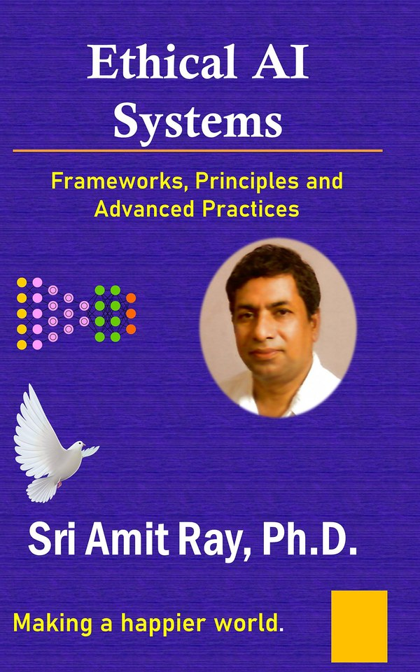

# Ethical AI Systems: Frameworks, Principles - The companion toolkit and Forms Workbook

[](https://github.com/compassionate-ai-lab/ethical-ai-systems/actions/workflows/tests.yml)
  



Companion code and worksheets for the book **Ethical AI Systems: Frameworks, Principles, and Advanced Practices for the Age of Autonomous Intelligence** by Dr. Sri Amit Ray ([Compassionate AI Lab](https://amitray.com/compassionate-ai-lab/), 2026; ISBN 978-81-69641-39-5 (Revised Expanded Edition, 2026)). First edition: Inner Light Publishers, 2022, ISBN 978-93-82123-54-5.

[The book](https://amitray.com/ethical-ai-systems-ebook/) addresses a fundamental question: How do we ensure that increasing machine autonomy never comes at the cost of human well-being, accountability, and freedom? Its answer is that the power to AI to act must remain connected to responsibility, care, and human freedom.
> This repository is the reference implementation of the book's operational tools:
>
> - **Ten-index scorecard**
> - **Autonomy ladder and oversight matrix**
> - **Consent and budget envelope**
> - **Subgroup fairness metrics**
> - **Action record**
>
> It also includes the eleven worksheets of the **Forms Workbook**

This repository holds the reference implementation of the book's operational instruments: the ten-index scorecard, the autonomy ladder and oversight matrix, the consent and budget envelope, subgroup fairness metrics and the action record. It also holds the eleven worksheets of the Forms Workbook.

## What Are Ethical AI Systems?

In [*Ethical AI Systems*](https://amitray.com/ethical-ai-systems-ebook/), an ethical AI system is not a model with good intentions. It is a set of **principles, processes and technical controls, in that order of dependency**. Together they make delegated intelligence usable:

> "Ethics is not a constraint bolted onto intelligence; it is what makes delegated intelligence usable." (Preface)

The question has changed from *what did the system say?* to ***what did it do, who allowed it, and who answers for the result?*** A chatbot that gives a wrong answer can mislead; an agent that acts on a wrong answer can change a life.

The book's Compassionate AI argument rests on four commitments that run through every chapter:

- **Do no harm is the first principle:** not the only principle, but the one that cannot be traded against efficiency. Harm includes the harm of omission.
- **Responsibility is human:** accountability is allocated before deployment, across developers, deployers, operators and users. Whoever answers for an action must have the authority to prevent or interrupt it and to arrange repair.
- **Oversight must be proportional and real:** autonomy is a ladder, not a switch. Each rung requires evidence, reversibility and a human stop.
- **Compassion is a design requirement:** reduce suffering, protect dignity and widen access, especially for people who cannot advocate for themselves. Like any specification, it can be tested.

Building on [Sri Amit Ray's Compassionate AI Architecture (CAIA™)](https://amitray.com/compassionate-ai-architecture/), the book reads *ahimsa* (non-harm) as **a discipline of choosing and repairing**. First exclude actions that violate rights or create unacceptable harm. Then compare the benefits of what remains, including the costs of delay and refusal. Finally, require an owner and a repair path for what stays uncertain. A large projected benefit can never buy permission for a severe, avoidable injury.

### Example: Why AI agents need it: the discharge agent

A hospital discharges a patient at six in the evening. The discharge agent books a home visit, orders a medication refill, sends a summary to the family and closes the case. Every step is logged as successful. Three days later the patient is readmitted, dehydrated. The refill went to a pharmacy that had closed, and the family summary was written in a language the household did not read.

The component checks reported success, but the service failed. The system optimised for completion and had no representation of the person it was completing the task for. The redesign in Chapter 1 does not need a better model. It writes down the permitted and prohibited actions, the authorisation, the harm limits, the evidence, a one-action human stop and a named owner. It also treats an unmet condition as a **stop**, not as an exception to be logged.

The same lesson closes the travel-agent example in Chapter 7:

> "Ethics for agents is enforced in the architecture around the model, because external controls can constrain tool access even when a model follows a malicious instruction."

### What the book provides

- **The service pyramid** (Chapter 3, Appendix B): seven levels of responsibility. They run from foundations (compute, energy, hardware and supply chain) through data, model, system, deployment and the service interface, to society and future generations. Each level has its own code of ethics. The pyramid is a map of responsibility, not of software components.
- **The ten ethical AI indexes** (Chapter 5, Appendix A): AI cage, AI traps detection, bias detection and mitigation, AI hostility data training, data source diversity, ethical data collection practices, transparency in data usage, data anonymisation and de-identification, ethical data augmentation, and human oversight and review. Each is scored 0–100 with explicit weights, a floor of 40 per index and a release threshold of 75, all declared before measurement.
- **The autonomy ladder** (Chapter 7, Appendix C): rung 0 suggest, 1 approve to act, 2 act and report, 3 act within limits, 4 bounded end-to-end autonomy. An oversight matrix by impact and reversibility sets each rung's ceiling: every high-impact or irreversible commitment stays at rung 1 at most.
- **Consent as an envelope** (Chapter 7): consent that is specific, bounded, confirmed at impact and revocable. Cumulative budgets, allowlisted recipients and identity-sharing rules are enforced outside the model.
- **Transparency, explainability and traceability** (Chapter 6): three words for three jobs. The chapter covers logs that let an uninvolved person reconstruct a decision, and the right to a reason and to contest it.
- **Safety, security and containment** (Chapter 8): safety cases, guardrails and their limits, containment engineering, supply chain, incident response, and the time available to remain in control.
- **Roboethics and domains** (Chapters 9–11): care and companion robots, dementia care, relational freedom, peacekeeping and violence control. It also covers health, drug design and pandemic response, military, disaster and public services, and democratic agency.
- **Governance and measurement** (Chapter 12): the governance stack from board to operators, the three lines of assurance, procurement as the strongest lever, public reporting, liability and redress, sustainability, a 2026–2030 roadmap and **twelve auditable commitments**.

### How it delivers it

Every chapter ends with a worked example and *Questions for Practice*. The examples are a discharge agent, a hiring model under three instruments, a hospital triage assistant, a sepsis dataset, a recruitment model, a loan-denial letter, a travel agent, red-teaming a coding agent, a dementia companion robot, a sepsis alert and a flood-response coordination agent. The scorecard, the autonomy matrix, the envelope and the fairness metrics are implemented in `ethical_ai_toolkit.py` and checked by tests, so a reader can rerun, change and extend them instead of taking them on trust. The Forms Workbook turns each instrument into a worksheet that a team can fill in and file.

## Sri Amit Ray quotes from the book

> "Doing no harm is the first principle of ethical AI systems." (Chapter 1)

> "Efficiency cannot compensate for a violation of human dignity." (Chapter 5)

> "Transparency becomes meaningful when the person affected can understand a decision and challenge it." (Chapter 6)

> "As AI gains speed and autonomy, human control must preserve the power and time to stop harmful actions before their consequences become irreversible." (Chapter 8)

> "Compassionate AI serves human relationships; it must never make dependence its measure of success." (Chapter 9)

> "Judge ethical AI by the harm it prevents, the failures it helps repair and the freedom it protects." (Chapter 12)

## Run it

```sh
git clone https://github.com/compassionate-ai-lab/ethical-ai-systems.git
cd ethical-ai-systems
python ethical_ai_toolkit.py                       # self-tests: prints "ethical_ai_toolkit: self-tests passed"
python -m unittest -v test_ethical_ai_toolkit.py   # 10 regression tests
```

Python 3.10 or later; standard library only. `TEST_RESULTS.txt` records the release run. The GitHub Actions workflow runs the tests on Python 3.10–3.13.

```python
from ethical_ai_toolkit import Assessment, Envelope, allowed_rung

scores = {"cage": 55, "traps": 71, "bias": 62, "hostility": 83, "diversity": 58,
          "collection": 74, "transparency": 66, "anonymisation": 80,
          "augmentation": 70, "oversight": 52}
print(Assessment(scores).summary())               # HOLD: composite 66.64
print(allowed_rung(2, 0))                         # 1  (high impact -> approve to act)

env = Envelope(40000, ["airline"], 25000)         # cap, allowlist, confirm-above (INR)
print(env.authorise("trip-01", 12000, "airline")) # {'allowed': True, 'reason': 'budget reserved'}
print(env.authorise("trip-02", 30000, "airline")) # {'allowed': False, 'reason': 'cumulative cap exceeded'}
```

## What the program computes

| Book | Function(s) | Main result |
|---|---|---|
| Ch 5, Appendix A: ten indexes | `INDEX_WEIGHTS`, `composite`, `Assessment` | Weights: bias 0.16, transparency 0.12, traps, hostility, diversity, collection and oversight 0.10 each, cage and anonymisation 0.08, augmentation 0.06. The recruitment model scores a composite of **66.64** against a release threshold of 75, so the decision is **HOLD**: fix the oversight gate (52) and extend subgroup testing, then re-score. |
| Ch 5.4–5.7: non-compensable constraints | `Assessment.blocking`, `Assessment.release` | Any index below the floor of 40 blocks release. The default is HOLD until evidence completeness and the mandatory legal, rights and safety gates are recorded as passed, so a high score never overrides a failed gate. Approved N/A indexes are excluded and the remaining weights renormalised. Missing evidence is not an exclusion. |
| Ch 7.4, Appendix C: autonomy ladder | `MAX_RUNG`, `allowed_rung`, `permits` | Impact (0–2) × reversibility (0–2) gives a rung ceiling: low impact allows 4 / 3 / 1, moderate 3 / 2 / 1, and high 1 / 1 / 1. The ceiling falls monotonically with harm and irreversibility, and a prohibited action stays prohibited. |
| Ch 7.3, 7.7: consent envelope | `Envelope.authorise`, `money` | A cumulative cap of 40,000 reserves 12,000 and then refuses 30,000 (cumulative cap exceeded). Other checks: confirmation above 25,000, a recipient allowlist, identity sharing off by default, revocation, a retried action ID never executing twice, and exact decimal money in one declared currency. |
| Ch 5.2: fairness definitions | `selection_rates`, `demographic_parity_difference`, `true_positive_rates`, `equal_opportunity_gap`, `calibration_by_group` | Subgroup selection rates, the parity gap (maximum minus minimum), the equal-opportunity gap and calibration bins per group. Undefined group rates are reported explicitly, never silently dropped. |
| Ch 6.5, Ch 12: traceability | `ActionRecord` | Action ID, UTC time, actor, operator, tool, authority, effect and model version, so that an uninvolved person can reconstruct a consequential action. Metadata cannot overwrite the authoritative fields. |

The inputs are small illustrative values chosen so that every step can be checked by hand. The weights, floor and threshold are the book's operational proposal, not a validated international standard. Replace them with values declared in advance for your own system, and add a test for each case you rely on.

## Forms Workbook (`forms/`)

These are eleven worksheets in a colour printable PDF, a black-and-white printable PDF, an editable DOCX and Markdown source (`forms.md`):

1. System Register Entry
2. Data Card
3. Model and System Card Summary
4. Ten-Index Scorecard
5. Autonomy Ladder Decision
6. Consent Envelope
7. Service Pyramid Review
8. Incident Report
9. Audit and Reconstruction Drill
10. Redress Log
11. Transparency Report Outline

Purchasers of the book may reproduce the worksheets for their own use and within their organisations.

## The book in brief

- **Part I, Foundations:** 1 The Ethical Mandate · 2 Frameworks and Instruments · 3 The Service Pyramid
- **Part II, Data and Models:** 4 Data Ethics · 5 Bias, Fairness and the Ten Ethical AI Indexes · 6 Transparency, Explainability and Traceability
- **Part III, Systems that Act:** 7 Agentic AI: Accountability, Consent and Oversight · 8 Safety, Security and Containment · 9 Human–Robot Interaction and Roboethics
- **Part IV, Domains and Institutions:** 10 Health, Science and Drug Design · 11 Ethics under Pressure: Military, Disaster and Public Services · 12 Governance, Measurement and the Road Ahead
- **Appendices:** A The Ten Indexes Scoring Rubric · B Service Pyramid Checklist · C Autonomy Ladder and Oversight Matrix · D Audit and Red Team Protocol · E The Companion Toolkit
- **Back matter:** Glossary · References (United Nations and international governance, European Union law, other legal and governance sources, research and foundational reading, works by the author) · About the Author

### Twelve commitments (Chapter 12.8)

1. Prevent severe, foreseeable and avoidable harm, including harm through omission; record residual risks and the reasons for accepting them.
2. Keep responsibility human, allocated before deployment and matched with authority to stop.
3. Scale autonomy to risk, earning each rung with evidence and reversibility.
4. Obtain real consent: specific, bounded, confirmed at impact, revocable.
5. Protect the vulnerable with stronger defaults and easier access to a human.
6. Measure bias across subgroups, publish the metric and act on the gap.
7. Document provenance, limitations and prohibited uses for data, models and systems.
8. Log every consequential action so that an uninvolved person can reconstruct it.
9. Provide a route to contest every decision that affects rights.
10. Bound the footprint: energy, water, materials and labour in the supply chain.
11. Refuse uses that undermine democracy, dignity or the rule of law, even when legal.
12. Leave the system better governed than you found it: tests, registers and reports that outlive the project.

## Get the book

- Full-colour PDF eBook (167 pages, with the toolkit and Forms Workbook): [amitray.com/ethical-ai-systems-ebook](https://amitray.com/ethical-ai-systems-ebook/)
- Kindle and paperback: see the book page for current publication links.
- Companion volumes with code: *Ahimsa in Agentic AI* ([compassionate-ai-lab/ahimsa-in-agentic-ai](https://github.com/compassionate-ai-lab/ahimsa-in-agentic-ai)) for single agents that act, and *No-Harm Principles in AI Architectures* ([compassionate-ai-lab/no-harm-principles](https://github.com/compassionate-ai-lab/no-harm-principles)) for systems of many agents.

## Related published books

1. Ray, Amit. *Ethical AI Systems: Frameworks, Principles, and Advanced Practices*. 1st ed., Inner Light Publishers, 2022. ISBN 978-93-82123-54-5.
2. Ray, Amit. *Human-Centered Compassionate AI*. Compassionate AI Lab, 2026. ISBN: 978-8169641050.
3. Ray, Amit. *Compassionate Artificial Intelligence: Frameworks and Algorithms*. Compassionate AI Lab, 2018. ISBN: 978-9382123460.
4. Ray, Amit. *Compassionate Artificial Superintelligence AI 5.0*. Compassionate AI Lab, 2018. ISBN: 978-9382123446.
5. Ray, Sri Amit. *Compassionate Superintelligence: Architecture, Alignment, and the Future of Intelligence That Cares*. 2nd ed., Compassionate AI Lab, 2026. ISBN 978-81-69641-22-7.
6. Ray, Sri Amit. *Ahimsa in Agentic AI: Algorithmic Non-Violence and the Architecture of Compassionate Code*. Compassionate AI Lab, 2026. ISBN 978-81-69641-29-6. Companion code: <https://github.com/compassionate-ai-lab/ahimsa-in-agentic-ai>
7. Ray, Sri Amit. *No-Harm Principles in AI Architectures: Ahimsa-Driven Multi-Agent AI Systems*. Compassionate AI Lab, 2026. ISBN 978-81-69641-30-2. Companion code: <https://github.com/compassionate-ai-lab/no-harm-principles>

## Compassionate AI Key Articles

These articles by Dr. Sri Amit Ray develop the frameworks the book builds on: the ten ethical AI indexes, the ethics of agentic AI, the Compassionate AI Architecture, the 12 Compassionate AI principles, CHFOA and HFOA, emotional AI and companions, and peacekeeping and social-care robots. They are listed from the most recent:

- Ray, Amit. "The Ethics of Agentic AI: Accountability, Consent and Human Oversight When AI Acts for Us." *Compassionate AI*, 3.10 (2026): 18–20. [https://amitray.com/ethics-of-agentic-ai-accountability-oversight/](https://amitray.com/ethics-of-agentic-ai-accountability-oversight/)
- Ray, Amit. "AI Companions and the Human Heart: An Ethical Framework for Emotional AI, Loneliness and Children (2026)." *Compassionate AI*, 3.10 (2026): 18–20. [https://amitray.com/ai-companions-ethics-emotional-dependency/](https://amitray.com/ai-companions-ethics-emotional-dependency/)
- Ray, Amit. "The Top 12 LLM Benchmarks in 2026: A Complete Guide to Evaluating Large Language Models." *Compassionate AI*, 3.10 (2026): 1–5. [https://amitray.com/top-12-llm-benchmarks/](https://amitray.com/top-12-llm-benchmarks/)
- Ray, Amit. "Can Quantum AI Become Conscious? The Sri Amit Ray Framework for Spontaneous Machine Awareness." *Compassionate AI*, 3.9 (2026): 30–32. [https://amitray.com/can-quantum-ai-become-conscious-spontaneous-machine-awareness/](https://amitray.com/can-quantum-ai-become-conscious-spontaneous-machine-awareness/)
- Ray, Amit. "Heart Disease Prevention with Agentic AI: Tools, Techniques, Mathematical Models, and AI Architectures." *Compassionate AI*, 3.8 (2026): 78–80. [https://amitray.com/heart-disease-prevention-agentic-ai/](https://amitray.com/heart-disease-prevention-agentic-ai/)
- Ray, Amit. "Compassionate AI in Health Care: A Comprehensive Review (2026)." *Compassionate AI*, 3.8 (2026): 63–74. [https://amitray.com/compassionate-ai-in-health-care-a-comprehensive-review/](https://amitray.com/compassionate-ai-in-health-care-a-comprehensive-review/)
- Ray, Amit. "The 25 Algorithms of the Sri Amit Ray Compassionate AI Architecture." *Compassionate AI*, 3.8 (2026): 63–65. [https://amitray.com/ray-25-compassionate-ai-algorithms/](https://amitray.com/ray-25-compassionate-ai-algorithms/)
- Ray, Amit. "Human-AI Emotional Resonance Algorithm: Ethical Emotional Co-Regulation in the Sri Amit Ray Compassionate AI Architecture (CAIA)." *Compassionate AI*, 2.6 (2026): 81–83. [https://amitray.com/human-ai-emotional-resonance-algorithm-compassionate-ai/](https://amitray.com/human-ai-emotional-resonance-algorithm-compassionate-ai/)
- Ray, Amit. "Build Your Own Agentic AI Healthcare MCP Server: A Complete Guide to AI-Powered Healthcare Agents." *Compassionate AI*, 3.8 (2026): 60–62. [https://amitray.com/agentic-ai-healthcare-mcp-server/](https://amitray.com/agentic-ai-healthcare-mcp-server/)
- Ray, Amit. "Medical AI Drones for Disaster Management: Intelligent Unmanned Health-Care Systems." *Compassionate AI*, 3.8 (2026): 57–59. [https://amitray.com/medical-ai-drones-for-disaster-management/](https://amitray.com/medical-ai-drones-for-disaster-management/)
- Ray, Amit. "The Sri Amit Ray Compassion Quotient (CQ) Algorithm for Compassionate AI." *Compassionate AI*, 2.6 (2026): 81–83. [https://amitray.com/compassion-quotient-cq-algorithm-compassionate-ai/](https://amitray.com/compassion-quotient-cq-algorithm-compassionate-ai/)
- Ray, Amit. "Collective Human Flourishing Optimization AI Algorithm (CHFOA): A Compassion-Centered Multi-Stakeholder AI Optimization Framework." *Compassionate AI*, 2.6 (2026): 90–92. [https://amitray.com/collective-human-flourishing-optimization-algorithm-chfoa/](https://amitray.com/collective-human-flourishing-optimization-algorithm-chfoa/)
- Ray, Amit. "Human Flourishing Optimization Algorithm (HFOA) for Compassionate AI Architecture." *Compassionate AI*, 2.6 (2026): 81–83. [https://amitray.com/human-flourishing-optimization-algorithm-hfoa-compassionate-ai/](https://amitray.com/human-flourishing-optimization-algorithm-hfoa-compassionate-ai/)
- Ray, Amit. "The Sri Amit Ray Compassionate AI Architecture (CAIA): A Seven-Layer Framework for Human-Centered Artificial Intelligence." *Compassionate AI*, 2.6 (2026): 81–83. [https://amitray.com/compassionate-ai-architecture/](https://amitray.com/compassionate-ai-architecture/)
- Ray, Amit. "Human-Centered Compassionate AI: The 25 Algorithms for Protecting Humanity and Future Generations." *Compassionate AI*, 2.6 (2026): 30–32. [https://amitray.com/human-centered-compassionate-ai-the-25-algorithms/](https://amitray.com/human-centered-compassionate-ai-the-25-algorithms/)
- Ray, Amit. "AI Consciousness and Self-Aware Robots: Sri Amit Ray’s Framework for Compassionate Intelligence." *Compassionate AI*, 2.5 (2026): 57–59. [https://amitray.com/ai-consciousness-self-aware-robots/](https://amitray.com/ai-consciousness-self-aware-robots/)
- Ray, Amit. "The 12 Sri Amit Ray Compassionate AI Principles | Ethical AI Framework." *Compassionate AI*, 2.4 (2026): 12–14. [https://amitray.com/the-12-compassionate-ai-principles-for-humanity-and-future-generations/](https://amitray.com/the-12-compassionate-ai-principles-for-humanity-and-future-generations/)
- Ray, Amit. "The Compassionate AI Lab Declaration on AI Safety, Suffering Reduction, and the Protection of Humanity." *Compassionate AI*, 4.12 (2025): 72–74. [https://amitray.com/compassionate-ai-declaration-protection-of-humanity/](https://amitray.com/compassionate-ai-declaration-protection-of-humanity/)
- Ray, Amit. "Compassionate AI for Forward Deployed Engineers (FDEs) in SaaS Companies." *Compassionate AI*, 4.11 (2025): 15–17. [https://amitray.com/compassionate-ai-for-forward-deployed-engineers-fdes-in-saas-companies/](https://amitray.com/compassionate-ai-for-forward-deployed-engineers-fdes-in-saas-companies/)
- Ray, Amit. "AI Agents and Robots in Peacekeeping Force and Social Care: Compassionate AI Technologies." *Compassionate AI*, 3.9 (2025): 75–77. [https://amitray.com/ai-agents-robots-peacekeeping-force-social-care-compassionate-ai/](https://amitray.com/ai-agents-robots-peacekeeping-force-social-care-compassionate-ai/)
- Ray, Amit. "Pain Recognition and Prediction AI Algorithm (PRPA) for Compassionate AI." *Compassionate AI*, 3.9 (2025): 60–62. [https://amitray.com/pain-recognition-and-prediction-algorithm-prpa-for-compassionate-ai/](https://amitray.com/pain-recognition-and-prediction-algorithm-prpa-for-compassionate-ai/)
- Ray, Amit. "The 7 Pillars of Compassionate AI Democracy." *Compassionate AI*, 3.9 (2024): 84–86. [https://amitray.com/the-7-pillars-of-compassionate-ai-democracy/](https://amitray.com/the-7-pillars-of-compassionate-ai-democracy/)
- Ray, Amit. "Compassionate AI-Driven Democracy: Power and Challenges." *Compassionate AI*, 3.9 (2024): 48–50. [https://amitray.com/compassionate-ai-driven-democracy-power-and-challenges/](https://amitray.com/compassionate-ai-driven-democracy-power-and-challenges/)
- Ray, Amit. "The 10 Ethical AI Indexes for LLM Data Training and Responsible AI." *Compassionate AI*, 3.8 (2023): 35–39. [https://amitray.com/the-10-ethical-ai-indexes-for-responsible-ai/](https://amitray.com/the-10-ethical-ai-indexes-for-responsible-ai/)
- Ray, Amit. "Ethical Responsibilities in Large Language AI Models: GPT-3, GPT-4, PaLM 2, LLaMA, Chinchilla, Gopher, and BLOOM." *Compassionate AI*, 3.7 (2023): 21–23. [https://amitray.com/ethical-responsibility-in-large-language-ai-models/](https://amitray.com/ethical-responsibility-in-large-language-ai-models/)
- Ray, Amit. "Calling for a Compassionate AI Movement: Towards Compassionate Artificial Intelligence." *Compassionate AI*, 2.6 (2023): 75–77. [https://amitray.com/calling-for-a-compassionate-ai-movement/](https://amitray.com/calling-for-a-compassionate-ai-movement/)
- Ray, Amit. "From Data-Driven AI to Compassionate AI: Safeguarding Humanity and Empowering Future Generations." *Compassionate AI*, 2.6 (2023): 51–53. [https://amitray.com/from-data-driven-ai-to-compassionate-ai-safeguarding-humanity-and-empowering-future-generations/](https://amitray.com/from-data-driven-ai-to-compassionate-ai-safeguarding-humanity-and-empowering-future-generations/)
- Ray, Amit. "Autophagy in AI: Destructive vs. Constructive." [https://amitray.com/autophagy-in-ai/](https://amitray.com/autophagy-in-ai/)
- Ray, Amit. "Five Steps to Building AI Agents with Higher Vision and Values." [https://amitray.com/building-ai-agents/](https://amitray.com/building-ai-agents/)
- Ray, Amit. "Artificial intelligence for Climate Change, Biodiversity and Earth System Models." *Compassionate AI*, 1.1 (2022): 54–56. [https://amitray.com/artificial-intelligence-for-climate-change-and-earth-system-models/](https://amitray.com/artificial-intelligence-for-climate-change-and-earth-system-models/)
- Ray, Amit. "Artificial Intelligence for Balance Control and Fall Detection of Elderly People." *Compassionate AI*, 4.10 (2018): 39–41. [https://amitray.com/artificial-intelligence-for-balance-control-and-fall-detection-system-of-elderly-people/](https://amitray.com/artificial-intelligence-for-balance-control-and-fall-detection-system-of-elderly-people/)
- Ray, Amit. "Artificial Intelligence to Combat Antibiotic Resistant Bacteria." *Compassionate AI*, 2.6 (2018): 3–5. [https://amitray.com/artificial-intelligence-for-antibiotic-resistant-bacteria/](https://amitray.com/artificial-intelligence-for-antibiotic-resistant-bacteria/)
- Ray, Amit. "Navigation System for Blind People Using Artificial Intelligence." *Compassionate AI*, 2.5 (2018): 42–44. [https://amitray.com/artificial-intelligence-for-assisting-blind-people/](https://amitray.com/artificial-intelligence-for-assisting-blind-people/)
- Ray, Amit. "Brain-Computer Interface and Compassionate Artificial Intelligence." *Compassionate AI*, 2.5 (2018): 3–5. [https://amitray.com/brain-computer-interface-compassionate-ai/](https://amitray.com/brain-computer-interface-compassionate-ai/)

## Cite as

**Book (MLA):**
Ray, Sri Amit. *Ethical AI Systems: Frameworks, Principles, and Advanced Practices for the Age of Autonomous Intelligence*. Revised expanded ed., Compassionate AI Lab, 2026. ISBN 978-81-69641-39-5.

**Book (APA):**
Ray, S. A. (2026). *Ethical AI systems: Frameworks, principles, and advanced practices for the age of autonomous intelligence* (Rev. expanded ed.). Compassionate AI Lab.

**Companion code:**
Ray, S. A. (2026). *Ethical AI Systems: companion toolkit* (Version 1.0.0) [Computer software]. Compassionate AI Lab. https://github.com/compassionate-ai-lab/ethical-ai-systems

**BibTeX:**

```bibtex
@book{ray2026ethicalai,
  author    = {Ray, Sri Amit},
  title     = {Ethical AI Systems: Frameworks, Principles, and Advanced Practices for the Age of Autonomous Intelligence},
  edition   = {Revised expanded},
  publisher = {Compassionate AI Lab},
  year      = {2026},
  isbn      = {978-81-69641-39-5},
  url       = {https://github.com/compassionate-ai-lab/ethical-ai-systems}
}
```

GitHub's **Cite this repository** button (from `CITATION.cff`) gives the same reference in APA and BibTeX.

## Release and validation: companion toolkit v1.0.0 (30 October 2026)

This release matches the 167-page full-colour PDF eBook and the 166-page paperback interior of the Revised Expanded Edition.

- `Assessment` defaults to HOLD until evidence completeness and the mandatory gates are explicitly recorded as passed. Scores reject non-finite and boolean values.
- The revised autonomy matrix limits every high-impact or irreversible commitment to rung 1 at most. Rung 4 is reserved for low-impact, fully reversible workflows.
- `Envelope` reserves cumulative budget instead of testing each payment against an isolated cap. A repeated action ID is never authorised to execute again and must be reconciled. Amounts use exact decimal arithmetic in one currency.
- The fairness functions reject invalid or empty inputs and report undefined group rates explicitly. The calibration bins count every sample.

Validation: the self-test passed and 10 unittest methods passed (`TEST_RESULTS.txt`). GitHub Actions runs them on Python 3.10–3.13. These checks cover the teaching examples and the stated policy boundaries. They do not establish production safety, legal compliance or regulatory conformity.

The book prints the SHA-256 of the companion package `Ethical_AI_Systems_Companion_Toolkit_v1.0.0.zip` on its copyright page and in Appendix E:

```
e1b62ee1c3ba5f679f96424f88b0d45afdd0437bb0c6cd26654908fe86d43d6e
```

**Boundary:** this is educational reference code. It is not a production authorisation service, a compliance certificate, concurrent transaction processing or cryptographic logging. A caller-supplied confirmation flag is not proof of human approval, and `ActionRecord` is a data schema, not tamper-evident storage.

Please report errors through the repository's Issues page.

## Licence

The code in this repository is released under the MIT License (see `LICENSE`). The worksheets in `forms/` may be reproduced by purchasers of the book for their own use and within their organisations. The text of the book is © 2026 Dr. Sri Amit Ray, all rights reserved.

About the lab: [Compassionate AI Lab](https://amitray.com/compassionate-ai-lab/) · More of the author's work: https://amitray.com · Other companion repositories: https://github.com/compassionate-ai-lab
